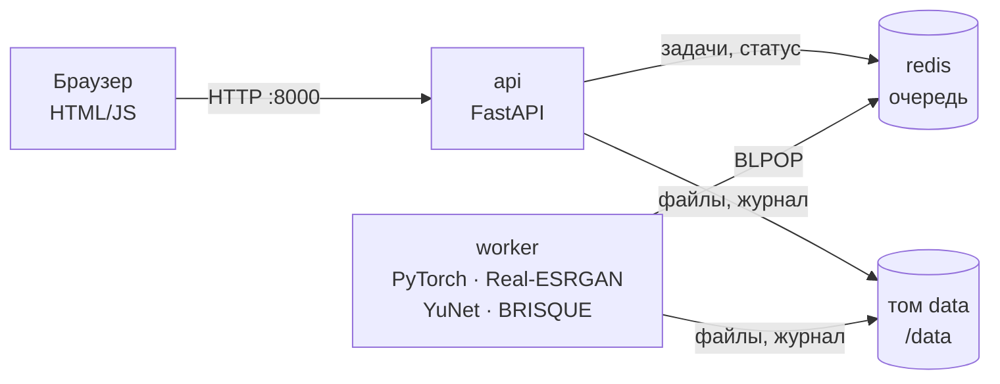

# Апскейлер — веб-сервис увеличения изображений на основе ИИ

Курсовой проект (ВятГУ, кафедра ЭВМ). Пользователь загружает изображение JPG/PNG/WEBP
(до 10 МБ и 2000×2000 px), выбирает увеличение ×2 или ×4 и получает результат модели
Real-ESRGAN x4plus со сравнением «до/после» и картой изменений. Сервис бесплатный,
без регистрации (анонимная сессия по cookie) и работает на ПК автора в Docker.

## Архитектура



| Контейнер | Что делает |
|---|---|
| `api` | Веб-интерфейс, проверка файлов, анонимная сессия, постановка в очередь, выдача результата, метрики |
| `worker` | Модерация (заглушка), детекция лиц, апскейл по фрагментам, карта изменений, BRISQUE, автоудаление файлов |
| `redis` | Очередь задач и их состояние (только в памяти) |

Задачи обрабатываются по одной: модель занимает всю видеопамять или все ядра CPU,
и параллельная обработка не ускорит работу.

## Запуск на Windows

### 1. Подготовка (один раз)

1. Установите Git: `winget install --id Git.Git -e` (или установщик с https://git-scm.com/download/win),
   затем **перезапустите PowerShell**. Без Git можно скачать проект архивом: Code → Download ZIP.
2. Установите [Docker Desktop](https://www.docker.com/products/docker-desktop/) и при установке
   оставьте включённым **WSL 2**. После установки перезагрузите ПК и запустите Docker Desktop.
3. Для GPU: обновите драйвер NVIDIA до последней версии (GeForce Experience или nvidia.com).
   Отдельно ставить CUDA Toolkit не нужно — Docker Desktop пробрасывает GPU через WSL 2.
4. Проверьте, что Docker видит видеокарту (в PowerShell):
   ```powershell
   docker run --rm --gpus all nvidia/cuda:12.4.1-base-ubuntu22.04 nvidia-smi
   ```
   Должна появиться таблица с RTX 3070. Если ошибка — см. раздел «Проблемы».

### 2. Запуск

```powershell
cd $HOME\Documents   # не запускайте из C:\Windows\System32
git clone https://github.com/samantt000/Upscaler-Project.git
cd Upscaler-Project
copy .env.example .env

# С видеокартой (основной режим, NFR-001):
docker compose -f docker-compose.yml -f docker-compose.gpu.yml up -d --build

# Без видеокарты (CPU):
docker compose up -d --build
```

Первая сборка долгая: образ воркера с CUDA скачивает около 3–4 ГБ. Повторные запуски
занимают секунды.

Чтобы GPU-режим запускался короткой командой `docker compose up -d --build`, раскомментируйте
в `.env` строку `COMPOSE_FILE=docker-compose.yml;docker-compose.gpu.yml`.

Откройте http://localhost:8000. Сервис готов, когда http://localhost:8000/api/health отвечает
`"status": "ready"` (воркер загрузил модель). Метрики — http://localhost:8000/metrics.

### 3. Управление

```powershell
docker compose ps                 # состояние контейнеров
docker compose logs -f worker     # журнал воркера (видно устройство: GPU или CPU)
docker compose down               # остановить
docker compose down -v            # остановить и удалить все файлы и журнал
```

С GPU-режимом в каждую команду добавляйте `-f docker-compose.yml -f docker-compose.gpu.yml`
(или настройте `COMPOSE_FILE` в `.env`).

### Доступ с других устройств

Сайт доступен в локальной сети по адресу `http://<IP-адрес ПК>:8000` (IP можно узнать
командой `ipconfig`). При первом обращении Windows может запросить разрешение в брандмауэре.
Доступ из интернета намеренно не настраивается (NFR-008, CON-005).

## Проверка требований

### Приёмочные тесты (FR-001, FR-002, FR-005, FR-009, NFR-008)

```powershell
pip install -r tests/requirements.txt
python tests/acceptance_test.py --url http://localhost:8000
python tests/acceptance_test.py --queue-limit   # дополнительно лимит очереди (на пустом сервисе)
```

### Нагрузочный тест (NFR-001, NFR-003)

```powershell
pip install -r loadtest/requirements.txt
locust -f loadtest/locustfile.py --host http://localhost:8000
```

Откроется интерфейс Locust на http://localhost:8089: задайте число пользователей и смотрите
строки `processing` (время обработки на сервере), `end-to-end` (очередь + обработка) и долю
отказов `POST /api/jobs` (HTTP 503 — сработала защита очереди). Без интерфейса, с сохранением CSV:

```powershell
locust -f loadtest/locustfile.py --host http://localhost:8000 --headless -u 20 -r 20 -t 10m --csv results/load
```

### Качество модели (NFR-004–006, FR-006, FR-012)

Скрипт запускается внутри контейнера воркера, чтобы считать на GPU. Пути — пример:

```powershell
# Набор A: DIV2K-val, PSNR/SSIM/LPIPS против эталона и бикубической интерполяции
docker compose -f docker-compose.yml -f docker-compose.gpu.yml run --rm `
  -v D:/datasets/DIV2K_valid_HR:/eval/hr -v ${PWD}/results:/results worker `
  python -m tools.eval_metrics ref --hr-dir /eval/hr --limit 100 --out /results/set_a.csv

# Набор B: то же с JPEG-сжатием и шумом
docker compose -f docker-compose.yml -f docker-compose.gpu.yml run --rm `
  -v D:/datasets/DIV2K_valid_HR:/eval/hr -v ${PWD}/results:/results worker `
  python -m tools.eval_metrics ref --degrade --hr-dir /eval/hr --limit 100 --out /results/set_b.csv

# Набор C: реальные фото — BRISQUE (базовая линия), снижение достройки на лицах, полное время
docker compose -f docker-compose.yml -f docker-compose.gpu.yml run --rm `
  -v D:/datasets/set_c:/eval/c -v ${PWD}/results:/results worker `
  python -m tools.eval_metrics noref --dir /eval/c --out /results/set_c.csv
```

Среднее BRISQUE по набору C впишите в `.env` как `BRISQUE_BASELINE` и перезапустите сервис:
после этого страница метрик показывает отклонение от базовой линии (FR-012).

Для замера времени на CPU (NFR-001, справочно) запустите сервис с `DEVICE=cpu` в `.env`.

## Где реализованы требования

| Требование | Реализация |
|---|---|
| FR-001 Загрузка файла | `api/app/validation.py`, проверка на клиенте в `api/app/static/app.js` |
| FR-002 Выбор масштаба | `api/app/main.py` (`create_job`), `worker/app/upscaler.py` (×2 — уменьшение результата ×4) |
| FR-003 Обработка ИИ-моделью | `worker/app/upscaler.py`, `worker/app/rrdbnet.py` |
| FR-004 Прогресс, «до/после», карта изменений, уведомления | `api/app/static/app.js`, `worker/app/pipeline.py`, `worker/app/quality.py` |
| FR-005 Анонимная сессия и защита очереди | `api/app/main.py` (cookie `sid`, Lua-скрипт `ENQUEUE`) |
| FR-006 Детекция лиц | `worker/app/faces.py`, `soften_faces` в `worker/app/pipeline.py` |
| FR-007 Модерация контента | `worker/app/moderation.py` — **заглушка**, см. ниже |
| FR-009 Выдача результата | `GET /api/jobs/{id}/download` |
| FR-010 Автоудаление файлов | `Worker.cleanup` в `worker/app/main.py`; кнопка «Удалить файлы сейчас» |
| FR-011 Журнал и метрики | `/data/logs/journal.jsonl`, `api/app/metrics.py`, страница `/metrics` |
| FR-012 Контроль качества (BRISQUE) | `worker/app/quality.py` (`Brisque`, `DriftMonitor`) |
| NFR-001 Время обработки | журнал + `loadtest/locustfile.py`, `tools/eval_metrics.py` |
| NFR-003 Нагрузка на очередь | `loadtest/locustfile.py` |
| NFR-004–006 PSNR, SSIM, LPIPS | `worker/tools/eval_metrics.py` |
| NFR-008 Изоляция данных сессий | `get_own_job` в `api/app/main.py` (чужая задача → 404), привязка порта в `docker-compose.yml` |
| NFR-009 Адаптивная вёрстка | `api/app/static/styles.css` |
| NFR-011 Успешность в пилоте | событие `downloaded` в журнале, «Доля скачиваний» на `/metrics` |
| NFR-013 Воспроизводимый запуск | `docker-compose.yml`, `docker-compose.gpu.yml`, `/api/health` |
| CON-001, CON-008 Лицензии | `docs/LICENSES.md` |
| CON-002, CON-005, CON-007 | только локальные контейнеры, внешних сервисов нет |

## Текущие ограничения

- **FR-007 (модерация) — заглушка**: все изображения пропускаются, в журнале отмечено
  `moderation: "stub"`. Пока сервис доступен только локально, это допустимо; изменение
  оформляется через CR (понижение до Should либо подключение классификатора).
- **SwinIR-M** как второй режим пока не подключён.
- **×2** получается уменьшением результата ×4 (модель x4plus одна на оба режима).
- Прозрачность PNG/WEBP не сохраняется: фон заменяется белым (пользователь видит уведомление).

## Проблемы

- `could not select device driver "nvidia"` — Docker не видит GPU. Обновите драйвер NVIDIA и
  Docker Desktop, проверьте в Settings → General, что включён WSL 2 based engine.
- `CUDA out of memory` в логах воркера — уменьшите `TILE_SIZE` в `.env` (например, до 256).
- Порт 8000 занят — поменяйте `HOST_PORT` в `.env`.
